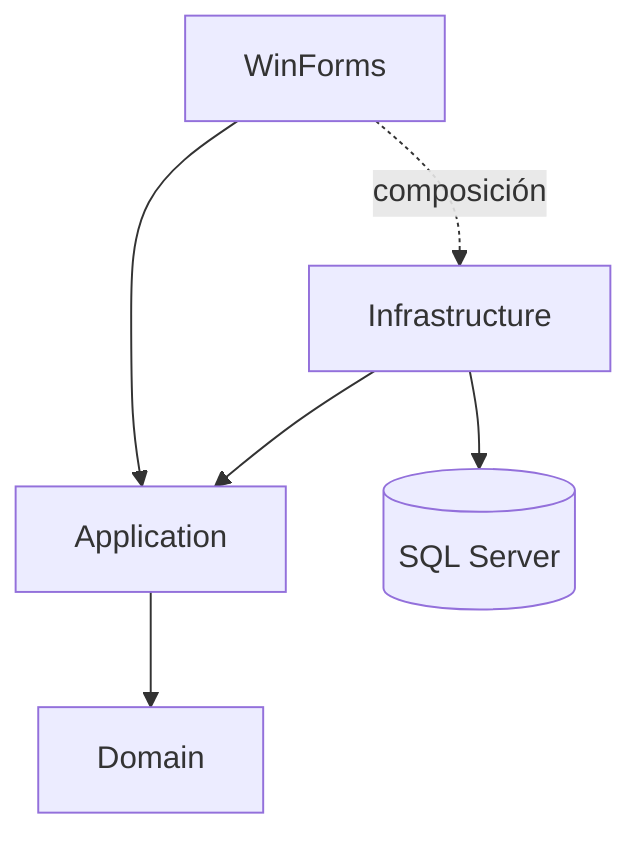

# ADR-001 Clean Architecture para WinForms

Estado: Proposed

## Contexto

La prueba pide una aplicación de escritorio con buenas prácticas y acceso a
SQL Server. El repositorio parte vacío y debe poder probar las reglas sin
instanciar controles de Windows.

## Alternativas

| Alternativa | Consecuencia |
|---|---|
| Lógica y SQL en formularios | Entrega rápida, pero reglas no aisladas y pruebas frágiles |
| N-capas con entidades de infraestructura | Separación parcial y contratos acoplados al proveedor |
| Clean Architecture | Dominio y casos de uso aislados, adaptadores reemplazables y más archivos iniciales |

## Decisión

Adoptar cuatro proyectos de producción. Domain no conoce frameworks. Application
define casos de uso, DTO y puertos. Infrastructure implementa ADO.NET y Serilog.
WinForms compone dependencias y traduce resultados a interacción.

Cómo leerlo: las dependencias de compilación apuntan hacia reglas internas.
Infrastructure y UI son adaptadores externos y pueden cambiar sin alterar el
dominio.

## Consecuencias

La solución tendrá más proyectos y una composición explícita. A cambio, los
tests de reglas no necesitan SQL Server ni un desktop runner y los contratos de
persistencia quedan revisables.

## Verificación

El build comprueba referencias permitidas y los tests unitarios ejecutan el
handler con dobles de los puertos. Un análisis manual verifica que ningún
formulario construya SQL ni exponga entidades de persistencia.
