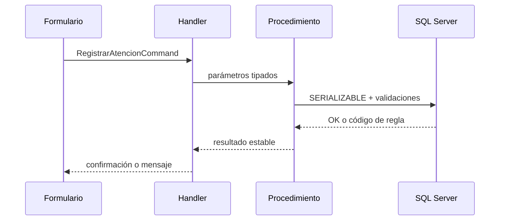

# ADR-002 Persistencia transaccional con procedimientos almacenados

Estado: Proposed

## Contexto

La prueba exige SQL Server, integridad referencial y uso de procedimientos
almacenados. La regla de duplicidad debe resistir dos intentos cercanos y el
detalle no puede quedar separado de su cabecera.

## Alternativas

| Alternativa | Consecuencia |
|---|---|
| Solo validar en WinForms | Se puede omitir con otra herramienta o carrera concurrente |
| ORM con migraciones como vía principal | Oculta el contrato de procedimientos exigido |
| Handler más procedimiento transaccional | Defensa en profundidad y contrato SQL explícito |

## Decisión

Usar ADO.NET parametrizado para invocar procedimientos. El procedimiento de
registro valida referencias y servicios activos, toma bloqueos serializables
sobre los índices de paciente y fecha, comprueba duplicidad, inserta cabecera y
detalle, y escribe auditoría. El detalle conserva paciente y fecha bajo una FK
compuesta hacia la cabecera para permitir el índice único
`(PacienteId, FechaAtencion, ServicioMedicoId)`. Las FK y restricciones UNIQUE
son la última línea de integridad.

Cómo leerlo: la validación de UI evita errores tempranos. El procedimiento es
la autoridad para concurrencia, integridad y auditoría.

## Consecuencias

El contrato de parámetros y códigos debe versionarse con el script. El acceso
es más explícito que un ORM y exige pruebas de integración contra SQL Server.
Las operaciones de lectura siguen procedimientos pequeños para que la cuenta
de ejecución no necesite permisos directos sobre tablas.

## Verificación

Las pruebas comprueban PK, FK, índices, duplicidad consecutiva y concurrente,
rollback, auditoría exitosa y auditoría de rechazo. Una revisión del diff busca
concatenación de SQL y permisos excesivos.
