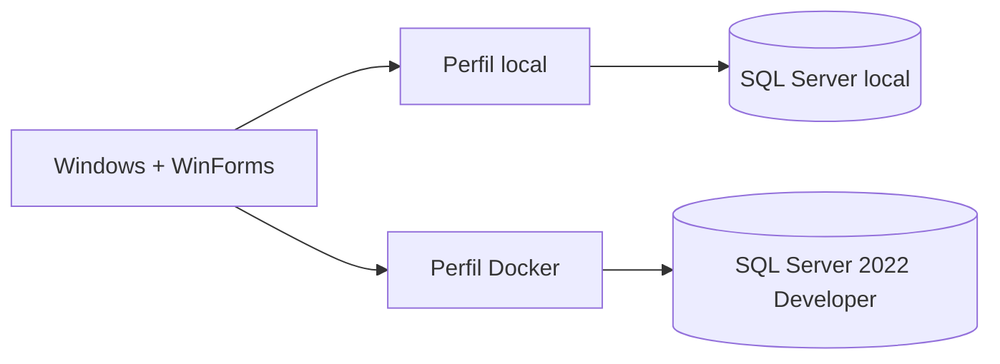

# ADR-003 Host Windows y SQL Server local o Docker

Estado: Proposed

## Contexto

WinForms requiere un entorno Windows. La prueba también solicita una opción
reproducible con Docker y SQL Server.

## Alternativas

| Alternativa | Consecuencia |
|---|---|
| Ejecutar todo en Docker | No ofrece una ruta natural para la GUI WinForms |
| Requerir siempre una instancia local | Configuración poco reproducible para otra persona |
| GUI en Windows y SQL Server local o contenedor | Mantiene la plataforma y ofrece dos rutas de datos |

## Decisión

Compilar y ejecutar WinForms en Windows. Proveer un `docker compose` para SQL
Server 2022 Developer, healthcheck, volumen persistente y scripts ordenados.
Proveer también un perfil de cadena de conexión para LocalDB o Express. La
selección del perfil ocurre por configuración sin duplicar código de negocio.

Cómo leerlo: ambos perfiles son adaptadores de infraestructura para el mismo
ejecutable y el mismo contrato de procedimientos.

## Consecuencias

La entrega debe documentar Docker Desktop, puertos, volumen, credenciales de
desarrollo y destrucción segura del entorno de prueba. La imagen no se usa
como almacén de secretos de producción.

## Verificación y reversa

Un smoke test se ejecuta una vez contra cada perfil. Si el contenedor falla,
se revisa healthcheck y logs, se restaura el volumen anterior si existía y se
comprueba que la aplicación puede volver al perfil local.
