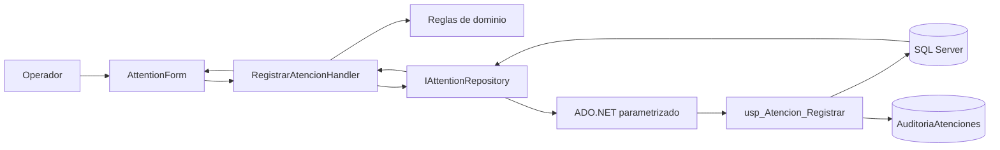

# Diseño

Estado: Proposed

## Solución y alternativas

Se propone una solución .NET 8 para Windows con WinForms y Clean Architecture.
La ventana WinForms se ejecuta en el host Windows. SQL Server se puede usar
desde una instancia local o desde un contenedor Docker. El contenedor no
intenta ejecutar la GUI.

La solución tendrá estos proyectos y límites.

```text
src/
  IpsAtenciones.Domain/          entidades y reglas puras
  IpsAtenciones.Application/     casos de uso, DTO y puertos
  IpsAtenciones.Infrastructure/  ADO.NET, procedimientos y Serilog
  IpsAtenciones.WinForms/        formularios, composición DI y mensajes
tests/
  IpsAtenciones.UnitTests/
  IpsAtenciones.IntegrationTests/
database/
  001-schema.sql
  002-programmability.sql
  003-seed.sql
deploy/docker-compose.yml
```

Flujo principal:



Cómo leerlo: la flecha hacia abajo cruza límites de dependencia desde la
presentación hacia puertos de aplicación y luego hacia infraestructura. La
base de datos conserva las reglas que no deben depender de la interfaz.

La lectura visual completa está separada en tres candidatos complementarios.
El [modelo de datos](system/candidates/bd/modelo-datos.md) contiene el ERD, el
diccionario mínimo, los índices y el flujo transaccional. Los [diagramas
C4](system/candidates/c4/ips-c4.md) muestran contexto, contenedores y
componentes. El [contrato de aplicación y API de referencia](system/candidates/api/ips-atenciones-api.md)
expone unicamente las interfaces C# que consume WinForms.

Se descarta Entity Framework como vía principal porque el requisito exige
procedimientos almacenados y el modelo es pequeño. ADO.NET reduce la
indirección del acceso y deja visible el contrato de parámetros. Se descarta
una API web porque no existe un consumidor HTTP en el alcance y añadiría una
frontera que la prueba no necesita. Se descarta ejecutar WinForms dentro de
Docker porque el contenedor solo resuelve SQL Server de forma reproducible.

## Contratos e impacto en lo existente

### Dominio y aplicación

- `Paciente` expone identificador técnico, tipo y número de documento, nombre y
  estado. La identificación completa no se escribe en logs.
- `ServicioMedico` expone identificador, código, nombre y `Activo`.
- `IPacienteCatalogService` e `IServicioCatalogService` exponen operaciones de
  crear, consultar, actualizar y desactivar logicamente.
- `Atencion` representa paciente, fecha de atención, fecha UTC de registro y
  una colección no vacía de `AtencionServicio`.
- `RegistrarAtencionCommand` recibe `PacienteId`, `FechaAtencion` y una lista
  distinta de `ServicioMedicoId`.
- `RegistrarAtencionHandler` valida campos, consulta el estado de los
  servicios, devuelve códigos de error estables y llama a
  `IAttentionRepository.RegistrarAsync` con `CancellationToken`.
- Los puertos `IPacienteQuery`, `IServicioMedicoQuery`, los servicios CRUD de
  catálogos y `IAttentionRepository` pertenecen a Application. No exponen entidades de
  persistencia ni controles WinForms.

### Presentación

`MainForm` contiene el registro de atención y abre `CatalogForm` para editar
catálogos. El registro agrupa paciente y fecha, lista de servicios activos,
estado de la operación y acciones. «Guardar atención» es la acción principal y
«Catálogos» abre el mantenimiento. La lista muestra código y nombre del
servicio y usa su identificador para conservar selecciones vigentes al recargar.

El mantenimiento tiene pestañas Pacientes y Servicios médicos. Cada pestaña
presenta registros y su estado, los campos del registro seleccionado y las
acciones Nuevo, Guardar y Desactivar. Nuevo limpia la selección, Guardar
mantiene el registro activo en la edición y Desactivar pide confirmación.
Los campos de documento del paciente quedan de solo lectura durante la edición.

Ambas ventanas usan filas de tamaño automático para etiquetas, entradas y
acciones, un área que se expande para la lista y una fila propia para mensajes.
El tamaño mínimo contiene los controles y sus etiquetas completas a 100 % y
125 % de escala. Los nombres de controles y el orden de Tab siguen la lectura
del formulario. La prueba visual cubre apertura, cambio de tamaño y acceso
por teclado en ambas ventanas.

La carga asíncrona sustituye la lista tras completar ambas consultas. Guardar
se habilita con paciente, fecha válida y servicios seleccionados. Mientras se
guarda, el formulario conserva el estado y bloquea el doble envío. El mensaje
de éxito identifica la atención. Un rechazo por duplicidad explica qué selección
debe corregirse. Un error de carga ofrece «Reintentar» y un resultado incierto
conserva el `OperacionId` para consultar la operación. Los mensajes visibles
usan español y omiten excepciones, códigos internos y detalles de configuración.

### Procedimientos almacenados

El script de programación incluirá como mínimo:

- `dbo.usp_Paciente_Listar`, `dbo.usp_Paciente_Crear`, `dbo.usp_Paciente_Actualizar`
  y `dbo.usp_Paciente_Desactivar`.
- `dbo.usp_ServicioMedico_ListarActivos`, `dbo.usp_ServicioMedico_Listar`,
  `dbo.usp_ServicioMedico_Crear`, `dbo.usp_ServicioMedico_Actualizar` y
  `dbo.usp_ServicioMedico_Desactivar`.
- `dbo.usp_Atencion_Registrar` para validar, insertar la cabecera y sus líneas,
  y escribir auditoría en una transacción.
- `dbo.usp_Atencion_ConsultarPorOperacion` para confirmar un intento por
  `OperacionId` y `dbo.usp_Atencion_Listar` para la consulta de historial por
  paciente y rango de fecha prevista en el contrato interno.

`usp_Atencion_Registrar` devolverá un código de resultado y el identificador de
atención. Los códigos mínimos serán `OK`, `PATIENT_REQUIRED`,
`SERVICE_REQUIRED`, `SERVICE_INACTIVE`, `REFERENCE_NOT_FOUND` y
`DUPLICATE_ATTENTION`. Todas las entradas serán parámetros tipados.

## Datos, fallos y seguridad

### Modelo relacional

El esquema usa nombres de negocio en español y claves sustitutas enteras.

| Tabla | Claves y columnas principales | Restricciones e índices |
|---|---|---|
| `Pacientes` | `PacienteId` PK, tipo y número de documento, nombre, fecha de nacimiento opcional, `Activo`, `CreadoUtc` | `UNIQUE (TipoDocumento, NumeroDocumento)`, índice de búsqueda por documento y nombre |
| `ServiciosMedicos` | `ServicioMedicoId` PK, `Codigo`, `Nombre`, `Activo`, `CreadoUtc` | `UNIQUE (Codigo)`, índice filtrado para `Activo = 1` y nombre |
| `Atenciones` | `AtencionId` PK, `PacienteId` FK, `FechaAtencion` `date`, `RegistradaUtc` | `UNIQUE (AtencionId, PacienteId, FechaAtencion)` para validar la FK compuesta y un índice `(PacienteId, FechaAtencion, AtencionId)` para historial |
| `AtencionServicios` | `AtencionServicioId` PK, `AtencionId`, `PacienteId`, `FechaAtencion`, `ServicioMedicoId`, `CreadoUtc` | FK compuesta hacia la cabecera, `UNIQUE (PacienteId, FechaAtencion, ServicioMedicoId)`, `UNIQUE (AtencionId, ServicioMedicoId)` e índices por servicio |
| `AuditoriaAtenciones` | `AuditoriaId` bigint PK, fecha UTC, operación, resultado, `AtencionId` nullable, `PacienteId` nullable, estación y versión de aplicación | índice `(FechaUtc, Operacion, Resultado)` y restricción de operación/resultado válidos |

La regla paciente-fecha-servicio se protege en `AtencionServicios` mediante el
índice único `(PacienteId, FechaAtencion, ServicioMedicoId)`. Las columnas de
paciente y fecha se repiten en el detalle para hacer declarativa la regla y la
FK compuesta hacia `Atenciones` obliga a que coincidan con la cabecera. El
procedimiento además usa `SERIALIZABLE` y `UPDLOCK/HOLDLOCK` sobre los índices
de paciente y fecha para devolver un código de duplicidad estable antes de
depender de la excepción de índice. La clave única de `(AtencionId,
ServicioMedicoId)` evita repetir el mismo servicio dentro de una cabecera.

La auditoría es append-only para el usuario de ejecución. Un registro exitoso
se inserta en la misma transacción. Para un rechazo, el procedimiento revierte
la transacción de negocio y después registra un evento de rechazo en una
transacción independiente, de modo que el evento sobreviva sin crear datos
parciales. Los datos de auditoría contienen identificadores técnicos y código
de resultado, nunca documentos completos, contraseñas, cadenas de conexión ni
texto clínico.

### Errores observables

| Entrada o fallo | Resultado de aplicación | Comprobación |
|---|---|---|
| Paciente vacío | Validación local, botón no ejecuta persistencia | Test unitario del handler |
| Lista de servicios vacía | Validación local y mensaje accionable | Test unitario del handler |
| Servicio inactivo | Código `SERVICE_INACTIVE`, sin filas de negocio | Test unitario y prueba del procedimiento |
| Paciente o servicio inexistente | Código `REFERENCE_NOT_FOUND`, rollback | Prueba de FK y procedimiento |
| Repetición paciente-fecha-servicio | Código `DUPLICATE_ATTENTION`, primera atención intacta | Prueba de integración consecutiva y concurrente |
| SQL Server detenido o timeout | Mensaje de disponibilidad y log técnico sin secretos | Test de adaptador y ejecución documentada |
| Error inesperado | Mensaje genérico con identificador de correlación, excepción solo en log seguro | Revisión manual y prueba de excepción |

### Seguridad y revisión OWASP

La aplicación usa una cuenta de ejecución de SQL Server con `EXECUTE` sobre los
procedimientos autorizados y `EXECUTE` y `REFERENCES` sobre el tipo de tabla
`dbo.AtencionServicioIdList`. La cuenta de instalación del script es distinta
y no se distribuye en el ejecutable. Las
cadenas de conexión se configuran por archivo local fuera del repositorio o por
variables de entorno del perfil Docker. Los parámetros ADO.NET y los nombres de
procedimiento bloquean inyección SQL.

La revisión documentará A01 acceso no autorizado a datos locales, A02 secretos
y cifrado, A03 inyección SQL, A04 límites y timeouts, A06 vulnerabilidades de
NuGet, A08 integridad de artefactos y A09 PII en logs. A05 CORS, A07
autenticación HTTP y A10 SSRF se marcarán como no aplicables porque no existe
una superficie web. La revisión separará auditoría de dependencias,
analizadores, pruebas de seguridad y revisión manual.

### Pruebas

- Unit tests con xUnit para invariantes de `Atencion`, validadores, códigos de
  error y traducción de excepciones.
- Integration tests contra SQL Server de Docker para esquema, procedimientos,
  FK, auditoría, índices, rollback, duplicidad y concurrencia.
- Prueba manual de WinForms para carga de catálogos, registro válido, errores y
  recuperación tras reconectar el servidor.
- Cobertura de líneas y ramas del código propio con el colector compatible con
  el runner elegido. Mutación queda fuera de alcance por decisión del usuario.

## Validación por requisito

| Requisito | Diseño o evidencia | Prueba prevista |
|---|---|---|
| REQ-001 | Consultas de catálogo y filtro `Activo` | Unit test de consulta y prueba de UI |
| REQ-002 | `AttentionForm` y `RegistrarAtencionCommand` | Test de handler y prueba manual |
| REQ-003 | Validador de aplicación | Unit tests de campos ausentes |
| REQ-004 | Validación duplicada en handler y procedimiento | Unit + integración SQL |
| REQ-005 | `SERIALIZABLE`, índice de paciente/fecha y consulta de detalle | Integración consecutiva y concurrente |
| REQ-006 | PK, FK, UNIQUE y transacción | Integración de rollback |
| REQ-007 | Referencias entre proyectos y ADO.NET parametrizado | Build, análisis estático e inspección |
| REQ-008 | Mapeo de errores y Serilog con redacción | Unit + revisión manual |
| REQ-009 | Perfil local y `docker compose` | Smoke test en ambos perfiles |
| REQ-010 | Tests, escaneo, README y scripts | Comandos de gates y revisión documental |
| REQ-011 | `AuditoriaAtenciones` e índices descritos | Integración y consulta de metadatos |
| REQ-012 | Formularios y procedimientos CRUD con desactivacion logica | Unit, integracion y prueba manual de catalogos |

## Despliegue y rollback

El perfil local usa una instancia SQL Server Express o LocalDB indicada por
`ConnectionStrings__IpsAtenciones`. El perfil Docker levanta SQL Server 2022
Developer con volumen persistente, espera healthcheck y ejecuta los scripts en
orden. La GUI se compila para Windows y recibe la cadena de conexión mediante
un archivo de configuración local no versionado.

La primera instalación crea esquema, procedimientos, índices, auditoría y
seed idempotente. Si una migración falla, se detiene antes de abrir la GUI y se
restaura el backup o volumen previo. Para volver atrás, se detiene la
aplicación, se restaura el último backup de SQL Server, se comprueba la versión
del esquema con una consulta de control y se ejecuta el smoke test de lectura.
No se borran tablas de atención automáticamente.

Cuando exista la solución, `harness-gates.yaml` reemplazará sus `TODO` por
comandos reales. La propuesta de cableado es `dotnet format --verify-no-changes`
para análisis estático, `dotnet test` para pruebas, `dotnet test` con
`XPlat Code Coverage` para cobertura, `dotnet list package --vulnerable
--include-transitive` para auditoría de dependencias y el flujo oficial de
SonarScanner for .NET para Sonar. El gate de mutación no se cableará.

## Preguntas abiertas

- Decision del dueno: se incluyen CRUD de pacientes y servicios. La eliminacion
  es desactivacion logica y conserva referencias historicas.
- Confirmar si la instancia local será LocalDB o Express. El contrato de
  configuración mantiene ambas opciones sin cambiar el código.
- Resolver antes de implementar cómo excluir el validador `mutation` del
  paquete `back-dot-net`, ya que la configuración actual del harness no tiene
  un campo de desactivación por gate.

## Revisión del prototipo local

La solución, los scripts y las pruebas existentes permiten comprobar el diseño
antes de la aceptación. Los resultados de la ejecución están en [tareas](tasks.md).

| Contrato | Diferencia observada en el prototipo | Comprobación pendiente tras la corrección |
|---|---|---|
| REQ-001, REQ-002, REQ-008 y REQ-012 | El servicio se muestra como un objeto C#, el catálogo se acumula al recargar, los botones se recortan y la duplicidad expone un código de aplicación. | Repetir el recorrido WinForms con una base limpia en LocalDB y en Docker. |
| REQ-006 y REQ-011 | El procedimiento acepta un conjunto vacío y la FK actual permite que la fecha de un detalle sea distinta de la cabecera. | Una llamada con TVP vacío devuelve `SERVICE_REQUIRED` sin cabecera; la FK compuesta rechaza un detalle inconsistente. |
| REQ-008 y REQ-009 | El script 004 otorga `REFERENCES` sobre el TVP y falta `EXECUTE`. La cuenta de aplicación no puede registrar. | Ejecutar las pruebas con la cuenta de ejecución creada por el script y comprobar que tampoco puede acceder directamente a las tablas. |
| REQ-011 y REQ-012 | El historial por paciente continúa pendiente y el procedimiento permite actualizar el tipo y número de documento. | Verificar consulta por paciente y rango, e inmutabilidad del documento en UI y persistencia. |

Decisiones confirmadas por el dueno durante el grill:

1. **Auditoria de rechazos: aceptada.** Se conservaran exitos y rechazos de
   reglas (`SERVICE_INACTIVE`, `DUPLICATE_ATTENTION` y referencias invalidas)
   con codigos tecnicos y sin documento completo.
2. **Autenticacion y operador: sin login en esta prueba.** El MVP registrara la
   estacion Windows sin cuentas ni roles.
3. **API: contrato interno.** WinForms consumira la interfaz C# de Application y
   no se implementara una API HTTP.
4. **Permisos: `EXECUTE`.** La cuenta de la aplicacion ejecutara procedimientos
   mediante ownership chaining o firma de modulos, sin escritura directa en
   tablas.
5. **Catalogos: CRUD incluido.** Pacientes y servicios tendran crear, consultar,
   actualizar y desactivar logicamente. La desactivacion conserva referencias
   historicas.

Estas decisiones quedan incorporadas a la propuesta, la spec y las tareas.

## Contratos de validación

- `RegistrarAtencionResult` contiene `Exitoso`, `CodigoResultado`, el ID de
  atención cuando existe y el `CorrelationId`. Los códigos acordados son
  `OK`, `PATIENT_REQUIRED`, `PATIENT_INACTIVE`, `SERVICE_REQUIRED`,
  `SERVICE_DUPLICATE`, `SERVICE_INACTIVE`, `REFERENCE_NOT_FOUND`,
  `DUPLICATE_ATTENTION`, `VALIDATION_ERROR`, `DATABASE_UNAVAILABLE`,
  `UNEXPECTED_ERROR` y `UNKNOWN_OUTCOME`.
- La lista completa de ambos catálogos se usa para mantenimiento. El registro
  filtra pacientes y servicios activos. El caso de uso rechaza un paciente
  inactivo con `PATIENT_INACTIVE` y un servicio repetido con `SERVICE_DUPLICATE`.
- `FechaAtencion` acepta la fecha local del día de operación.
  `FechaNacimiento` es opcional y se valida contra fechas futuras. Tipo y número
  de documento se fijan al crear el paciente. Nombre, nacimiento y estado se
  pueden cambiar conservando el `PacienteId`.
- Los campos de catálogo se validan al aplicar límites del esquema. Las claves
  se normalizan con `Trim` y mayúsculas y usan `Latin1_General_100_CI_AI`.
  Las pruebas cubren duplicados con espacios y diferencias de mayúsculas.
- La consulta de historial se expone en `IAtencionService.ListarAtencionesAsync`.
  Las pruebas SQL validan la relación cabecera-detalle, las referencias, el
  rollback, la auditoría, los índices y la concurrencia.
- El procedimiento usa `TRY/CATCH`, consultas bajo `SERIALIZABLE` y
  `XACT_STATE()` para revertir. Las infracciones de unicidad de la regla se
  traducen a `DUPLICATE_ATTENTION`. Si falla la auditoría independiente de un
  rechazo, se conserva su resultado y queda una alerta técnica con correlativo.

## Resultado incierto y evidencia

El GUID `OperacionId` identifica el intento y queda en auditoría. Una
cancelación anterior al envío termina sin persistencia. Tras una cancelación o
timeout posterior al envío, la aplicación consulta el intento por ese GUID.
Mientras no haya confirmación, muestra `UNKNOWN_OUTCOME` y permite consultar
otra vez con el mismo ID. Las pruebas controlan la cancelación antes del envío,
después del envío y después del commit.

La semilla idempotente provee un paciente y un servicio para cada estado de
actividad. Las pruebas localizan esos datos por sus claves de negocio. La
revisión de seguridad registra SAST, SCA, revisión manual, comandos, fuentes y
hallazgos con archivo, impacto y remediación en `docs/security/owasp-review.md`.
