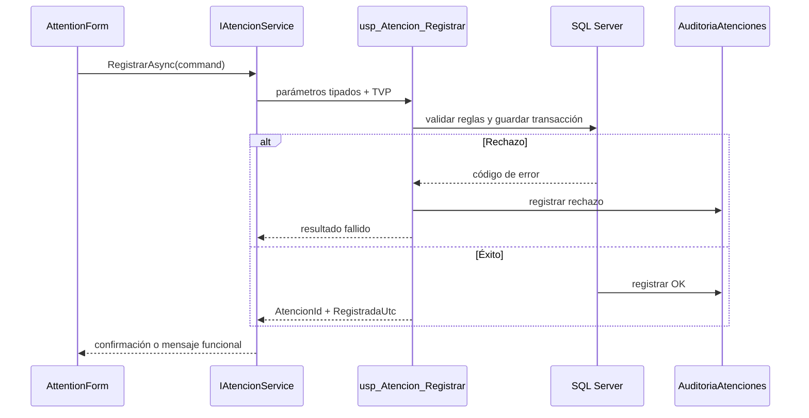

# Contrato de aplicación y API de referencia IPS

Implementación: Pending

Estado: Proposed

## Alcance

La primera entrega es una aplicacion WinForms sin servidor HTTP. Este documento
define el contrato interno de la capa Application. El contrato vigente de la
aplicacion es la interfaz C# y el procedimiento almacenado.

## API de aplicación

```csharp
public interface IAtencionService
{
    Task<IReadOnlyList<PacienteOption>> ListarPacientesAsync(
        CancellationToken cancellationToken);

    Task<IReadOnlyList<ServicioOption>> ListarServiciosActivosAsync(
        CancellationToken cancellationToken);

    Task<IReadOnlyList<ServicioOption>> ListarServiciosTodosAsync(
        CancellationToken cancellationToken);

    Task<IReadOnlyList<AtencionResumen>> ListarAtencionesAsync(
        int pacienteId,
        DateOnly desde,
        DateOnly hasta,
        CancellationToken cancellationToken);

    Task<ResultadoCatalogo> CrearPacienteAsync(
        CrearPacienteCommand command,
        CancellationToken cancellationToken);

    Task<ResultadoCatalogo> ActualizarPacienteAsync(
        ActualizarPacienteCommand command,
        CancellationToken cancellationToken);

    Task<ResultadoCatalogo> DesactivarPacienteAsync(
        int pacienteId,
        CancellationToken cancellationToken);

    Task<ResultadoCatalogo> CrearServicioAsync(
        CrearServicioCommand command,
        CancellationToken cancellationToken);

    Task<ResultadoCatalogo> ActualizarServicioAsync(
        ActualizarServicioCommand command,
        CancellationToken cancellationToken);

    Task<ResultadoCatalogo> DesactivarServicioAsync(
        int servicioMedicoId,
        CancellationToken cancellationToken);

    Task<RegistrarAtencionResult> RegistrarAsync(
        RegistrarAtencionCommand command,
        CancellationToken cancellationToken);
}

public sealed record PacienteOption(int PacienteId, string Documento, string NombreCompleto, bool Activo);
public sealed record ServicioOption(int ServicioMedicoId, string Codigo, string Nombre, bool Activo);
public sealed record AtencionResumen(long AtencionId, int PacienteId, DateOnly FechaAtencion, IReadOnlyList<ServicioOption> Servicios);

public sealed record ResultadoCatalogo(bool Exitoso, string CodigoResultado);

public sealed record CrearPacienteCommand(string TipoDocumento, string NumeroDocumento, string NombreCompleto, DateOnly? FechaNacimiento);
public sealed record ActualizarPacienteCommand(int PacienteId, string NombreCompleto, DateOnly? FechaNacimiento, bool Activo);
public sealed record CrearServicioCommand(string Codigo, string Nombre);
public sealed record ActualizarServicioCommand(int ServicioMedicoId, string Nombre, bool Activo);

public sealed record RegistrarAtencionCommand(
    int PacienteId,
    DateOnly FechaAtencion,
    IReadOnlyCollection<int> ServicioMedicoIds,
    string Estacion,
    string VersionAplicacion,
    Guid OperacionId);

public sealed record RegistrarAtencionResult(
    bool Exitoso,
    string CodigoResultado,
    long? AtencionId,
    DateTimeOffset? RegistradaUtc,
    string CorrelationId);
```

El servicio devuelve errores tipados o códigos de dominio. La presentación
decide el texto visible y no recibe excepciones de SQL Server como contrato.



Cómo leerlo: `IAtencionService` es el contrato estable para la GUI. El
procedimiento es la frontera que conserva integridad y auditoría, y el TVP
representa el conjunto de servicios de una sola atención.

## Superficie fuera de alcance

La aplicacion WinForms invoca el contrato C# de Application. No se implementara
un endpoint HTTP en esta prueba. No se agregan hosting, autenticacion web ni
DAST como entregables.

## Contrato del procedimiento

`dbo.usp_Atencion_Registrar` recibe `@PacienteId`, `@FechaAtencion`, `@OperacionId`, una lista
de servicios como TVP `dbo.AtencionServicioIdList` con clave primaria sobre
`ServicioMedicoId`, `@Estacion` y `@VersionAplicacion`. `Estacion` se limita a 100
caracteres y `VersionAplicacion` a 50. La cuenta de ejecución recibe
`EXECUTE` y `REFERENCES` sobre el tipo TVP y `EXECUTE` sobre los procedimientos. Devuelve `@CodigoResultado`, `@AtencionId` y
`@RegistradaUtc`. El TVP impide enviar el mismo servicio dos veces desde el
adaptador y las restricciones SQL son la defensa final.

| Código | Significado | Mapeo de UI |
|---|---|---|
| `OK` | Atención creada | Confirmación con identificador |
| `PATIENT_REQUIRED` | Paciente ausente | Validación del formulario |
| `SERVICE_REQUIRED` | Lista vacía | Validación del formulario |
| `SERVICE_INACTIVE` | Servicio no seleccionable | Mensaje de catálogo |
| `REFERENCE_NOT_FOUND` | Paciente o servicio inexistente | Revisar catálogo |
| `DUPLICATE_ATTENTION` | Paciente, fecha y servicio ya existen | Corregir fecha o servicio |
| `DATABASE_UNAVAILABLE` | Timeout o conexión no disponible | Reintentar o revisar entorno |

## Compatibilidad y seguridad

El contrato usa identificadores técnicos y `date` para la fecha de negocio.
`DateTimeOffset` solo se usa para el instante UTC de registro. Las entradas se
parametrizan, la cuenta de ejecución invoca procedimientos y los mensajes no
incluyen SQL, cadenas de conexión ni documentos completos.
