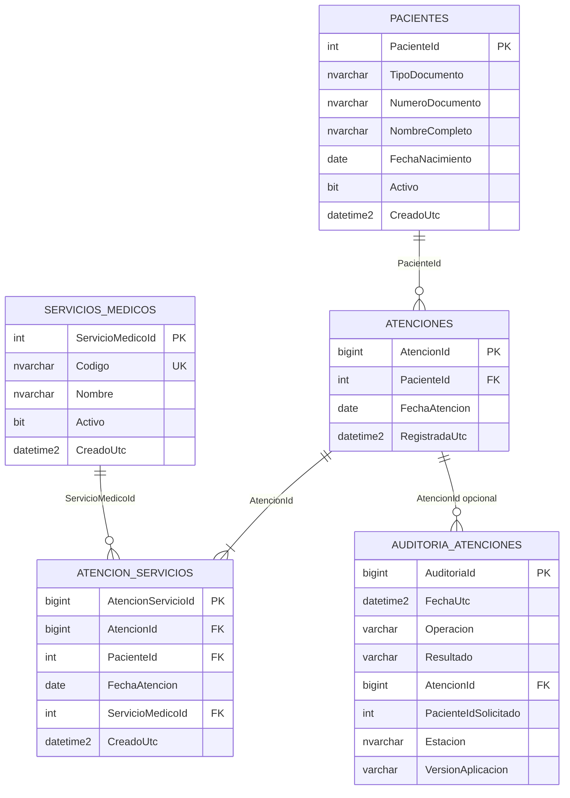
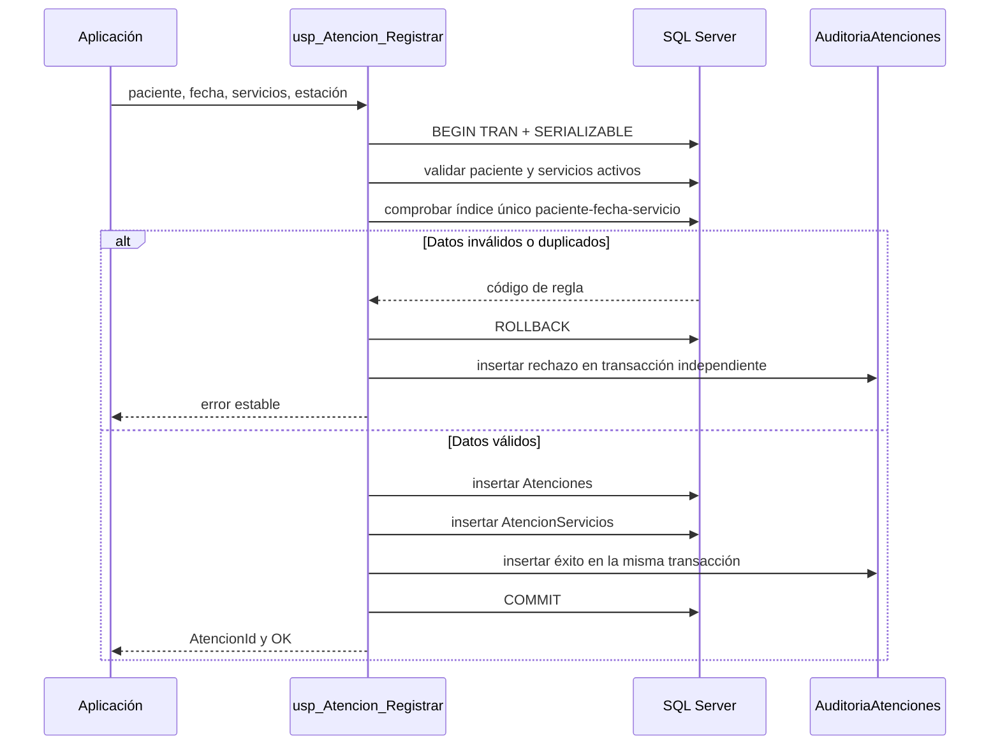

# Candidato de modelo de datos IPS

Implementación: Pending

Estado: Proposed

## Estado

Candidato para conciliación posterior a la implementación. El diseño propone
las tablas `Pacientes`, `ServiciosMedicos`, `Atenciones`,
`AtencionServicios` y `AuditoriaAtenciones`, con PK, FK, restricciones de
unicidad e índices de búsqueda. El detalle repite paciente y fecha bajo una FK
compuesta controlada para sostener el índice único
`(PacienteId, FechaAtencion, ServicioMedicoId)`. La transacción serializable de
`usp_Atencion_Registrar` devuelve el error de duplicidad de forma estable.

## Cómo leer el modelo

El diagrama entidad-relación muestra primero las relaciones de negocio y luego
las columnas que sostienen cada regla. Las columnas `PacienteId` y
`FechaAtencion` del detalle son una duplicación controlada. La FK compuesta
obliga a que coincidan con la cabecera y permite declarar la unicidad exacta de
paciente, día y servicio en SQL Server.

## Diagrama entidad-relación

### Diccionario mínimo

| Tabla | Columna | Tipo | Nulo | Regla |
|---|---|---|---|---|
| `Pacientes` | `PacienteId` | `int identity` | No | PK estable |
| `Pacientes` | `TipoDocumento`, `NumeroDocumento` | `nvarchar` | No | UNIQUE compuesto, sin escribirse en logs |
| `Pacientes` | `NombreCompleto` | `nvarchar(200)` | No | Texto requerido |
| `ServiciosMedicos` | `ServicioMedicoId` | `int identity` | No | PK estable |
| `ServiciosMedicos` | `Codigo` | `nvarchar(30)` | No | UNIQUE, código de catálogo |
| `ServiciosMedicos` | `Activo` | `bit` | No | Solo `1` se puede registrar |
| `Atenciones` | `AtencionId` | `bigint identity` | No | PK de cabecera |
| `Atenciones` | `PacienteId`, `FechaAtencion` | `int`, `date` | No | FK al paciente e índice de historial |
| `AtencionServicios` | `PacienteId`, `FechaAtencion` | `int`, `date` | No | Copia controlada de la cabecera bajo FK compuesta |
| `AtencionServicios` | `ServicioMedicoId` | `int` | No | FK a servicio médico |
| `AuditoriaAtenciones` | `Operacion`, `Resultado` | `varchar` | No | Valores controlados por `CHECK` |
| `AuditoriaAtenciones` | `PacienteIdSolicitado` | `int` | S? | Valor observado de la solicitud, sin FK para poder auditar referencias inv?lidas |

## Índices y restricciones

| Nombre | Definición | Propósito |
|---|---|---|
| `UQ_Pacientes_Documento` | `UNIQUE (TipoDocumento, NumeroDocumento)` | Evitar pacientes repetidos |
| `UQ_ServiciosMedicos_Codigo` | `UNIQUE (Codigo)` | Identificar el servicio del catálogo |
| `IX_ServiciosMedicos_Activos_Nombre` | Filtrado por `Activo = 1`, ordenado por `Nombre` | Cargar el selector de la ventana |
| `IX_Atenciones_Paciente_Fecha` | `(PacienteId, FechaAtencion, AtencionId)` | Historial y bloqueo de concurrencia |
| `UQ_AtencionServicios_Paciente_Fecha_Servicio` | `UNIQUE (PacienteId, FechaAtencion, ServicioMedicoId)` | Regla de no duplicidad solicitada |
| `UQ_AtencionServicios_Atencion_Servicio` | `UNIQUE (AtencionId, ServicioMedicoId)` | Un servicio una vez por cabecera |
| `IX_AtencionServicios_Servicio` | `(ServicioMedicoId, FechaAtencion)` | Consultas por servicio y día |
| `IX_AuditoriaAtenciones_Fecha_Operacion` | `(FechaUtc, Operacion, Resultado)` | Auditoría y soporte operativo |

La FK compuesta `(AtencionId, PacienteId, FechaAtencion)` de
`AtencionServicios` referencia la clave única equivalente de `Atenciones`.
Esto mantiene consistentes las columnas repetidas y evita que una línea se
asocie a otra cabecera por error.

## Flujo transaccional de registro

## Contrato de auditoría

`AuditoriaAtenciones` es append-only para el usuario de ejecución. `Operacion`
usa `REGISTRAR_ATENCION` y `Resultado` usa `OK`, `SERVICE_INACTIVE`,
`DUPLICATE_ATTENTION`, `REFERENCE_NOT_FOUND` o `VALIDATION_ERROR`. Se conserva
el identificador técnico, la estación y la versión de aplicación. El nombre y
el número de documento del paciente no se almacenan en el evento.

## Inicialización y reversa

El script se ejecuta en este orden. esquema y tipos, tablas y restricciones,
índices, procedimientos, permisos de la cuenta de ejecución, seed idempotente y
prueba de humo. Un fallo detiene la instalación. La reversa restaura el backup
o volumen previo y verifica la existencia de las tablas, índices y
procedimientos antes de reabrir la aplicación.

## Lectura

La cabecera identifica paciente y fecha. El detalle relaciona cada servicio una
sola vez. La auditoría conserva el resultado técnico de cada intento sin
reemplazar la información clínica, que está fuera de alcance.

## Control de version del esquema

`SchemaVersion` contiene una sola fila con `VersionActual` y `AplicadoUtc`.
Los scripts `001`, `002` y `003` validan la version previa, aplican una vez y
actualizan la fila. Una repeticion devuelve estado idempotente. La reversa
restaura el backup y valida que `VersionActual` vuelva al numero anterior.
