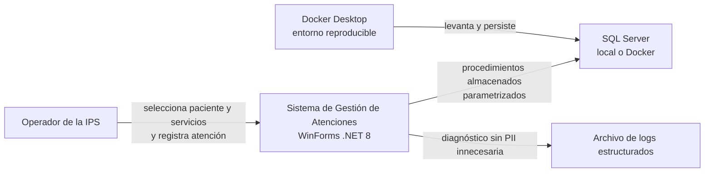
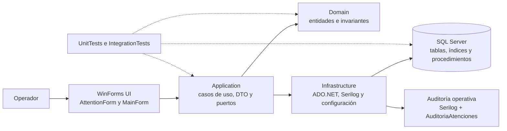
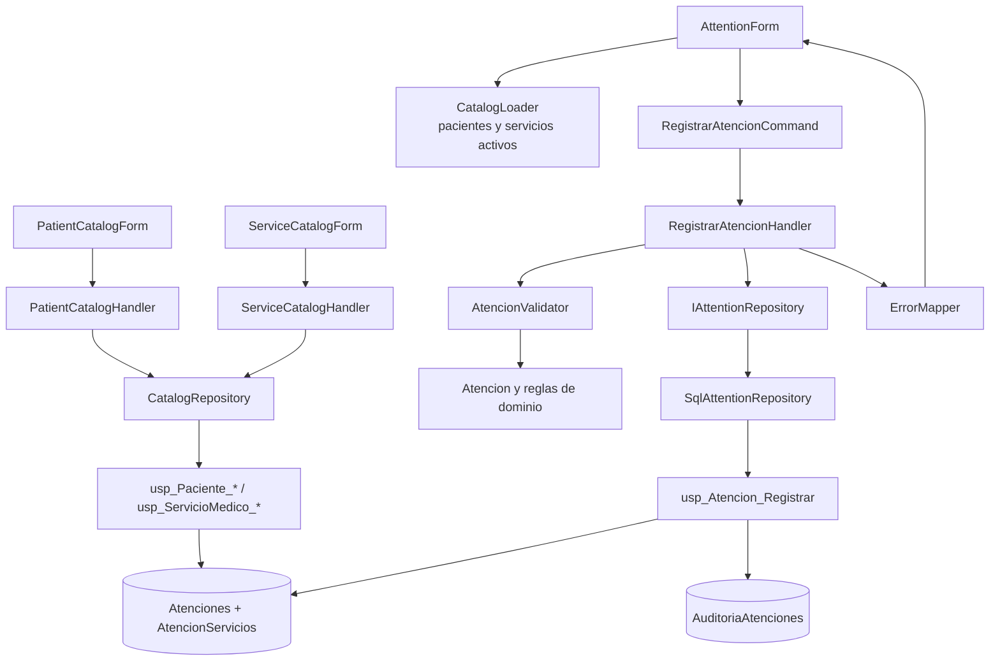
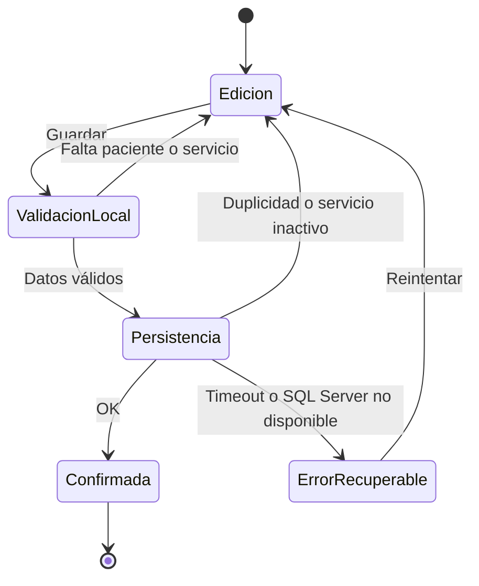

# Diagramas C4 de la aplicación IPS

Implementación: Pending

Estado: Proposed

## Alcance y guía de lectura

Los diagramas describen la solución propuesta en tres niveles. L1 muestra los
actores y sistemas externos. L2 separa la GUI, la aplicación, la
infraestructura, SQL Server y las pruebas. L3 explica el camino de registro de
una atención. Las flechas representan llamadas o dependencias, y la dirección
de lectura es de izquierda a derecha.

## C4 nivel 1 — Contexto

## C4 nivel 2 — Contenedores

## C4 nivel 3 — Componentes del registro

## Responsabilidades y contratos

| Componente | Responsabilidad | Contrato observable |
|---|---|---|
| `AttentionForm` | Capturar paciente, fecha y servicios | No permite guardar sin datos obligatorios |
| `PatientCatalogForm` | Crear, consultar, actualizar y desactivar pacientes | Valida documento ?nico y conserva referencias |
| `ServiceCatalogForm` | Crear, consultar, actualizar y desactivar servicios | Un servicio inactivo no aparece para nuevas atenciones |
| `CatalogLoader` | Consultar catálogos | Excluye servicios inactivos |
| `RegistrarAtencionHandler` | Orquestar validación y persistencia | Devuelve `OK` o códigos de regla estables |
| `AtencionValidator` | Aplicar reglas antes de I/O | Pruebas unitarias sin SQL Server |
| `SqlAttentionRepository` | Ejecutar procedimientos con parámetros | Nunca concatena valores del formulario |
| `usp_Atencion_Registrar` | Aplicar invariantes, transacción e índices | Rollback completo y auditoría |
| `ErrorMapper` | Convertir resultado técnico a mensaje funcional | No expone SQL ni stack trace |

## Flujo de errores

El diagrama permite ubicar cada mensaje en la frontera correcta. La validación
local evita viajes innecesarios, y SQL Server mantiene la autoridad cuando la
entrada llega por otra ruta o existe concurrencia.
